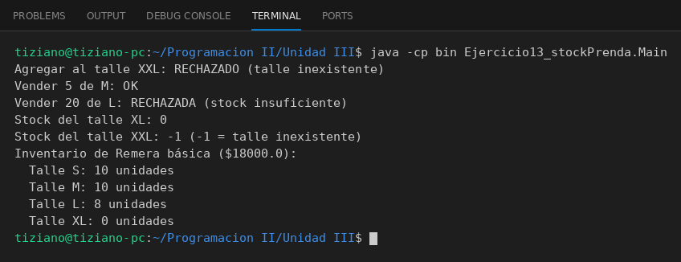

# Prenda

Programación II - Unidad 3 - Ejercicio 13

## Consigna
Modelar la clase aplicando encapsulamiento: atributos privados y métodos públicos que validan antes de modificar el estado. El stock por talle de una prenda con un `Map` privado.

## Lógica
- `Map<String,Integer>` privado con los talles S, M, L y XL.
- `consultarStock(talle)` devuelve la cantidad (o -1 si el talle no existe).
- `agregarStock` y `vender` validan que el talle exista y que el stock no quede negativo.
- `mostrarInventario()` imprime el resultado.

## Ejecución

